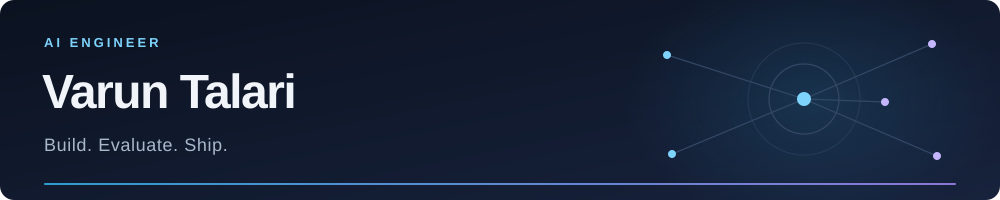

**Applied AI Engineer** · San Francisco Bay Area · Open to full-time Applied AI / AI Engineer roles

[Portfolio](https://varuntx.us) · [Selected work](#selected-work) · [Writing](https://varuntx.us/blog/) · [LinkedIn](https://www.linkedin.com/in/varun-talari-8b301620b) · [Email](mailto:hi@varuntx.us)

---

I build AI agents and the evaluations that prove they work, then ship them as complete products: the APIs, interfaces and infrastructure around them. I use failure traces and feedback to decide what to improve, and I measure whether the change helped.

### Selected work

**[Orchestra Review](https://github.com/VarunTx/orchestra-review): finds the mistakes your coding agent keeps repeating**  
Reads the session logs Claude Code, Codex and OpenCode keep on your machine, finds mistakes that recur across sessions, fixes each with one instruction line, and measures whether the fix worked. In 67,074 public agent runs, 41% of failures with an identifiable cause repeated a mistake seen in another repository.  
[Try it in the browser](https://review.varuntx.us) (nothing is uploaded) · [PyPI](https://pypi.org/project/orchestra-review/) · [Research and limits](https://github.com/VarunTx/orchestra-review/tree/main/research)

**[HarnessOps](https://github.com/VarunTx/harness-ops): agent improvement through feedback and evals**  
A support agent whose instructions, skills and memory live as Git-versioned Markdown, with human-reviewed instruction changes. Each evaluation records the harness commit it tested. On small scenario sets, reported runs improved **3/14 → 14/14 in development** and **2/10 → 10/10 on a separate holdout**.  
[Case study](https://github.com/VarunTx/harness-ops/blob/main/docs/CASE_STUDY.md)

**[pytest-agent-behavior](https://github.com/VarunTx/pytest-agent-behavior): deterministic tests for agent behavior**  
A pytest plugin that checks recorded agent traces for regressions in tool selection, approval ordering, call counts and repeated identical calls. Runs locally with no LLM calls, API keys or hosted service.  
[PyPI](https://pypi.org/project/pytest-agent-behavior/)

**[Deposit Kit](https://github.com/VarunTx/deposit-kit): proof of a rental's condition, for renters**  
A free web app for US renters to record a home at move-in, or a rental car at pickup and return. Photos stay on the phone; each photo's hash gets an independent RFC 3161 timestamp, and the record exports as a PDF and a verifiable zip.  
[Live](https://depositkit.varuntx.us)

**[Orchestra AI](https://github.com/VarunTx/orchestra-ai): self-hosted control plane on Conductor OSS** (earlier project)  
Projects, health checks, incidents and durable workflows in one dashboard, with scoped API tokens and an MCP server so coding agents can operate it. Orchestra Review grew out of it.

---

**Looking for full-time Applied AI and AI Engineer roles** where I can turn an ambiguous problem into a working feature, own the software around it, and keep improving it after launch. The fastest way to reach me is [hi@varuntx.us](mailto:hi@varuntx.us).
