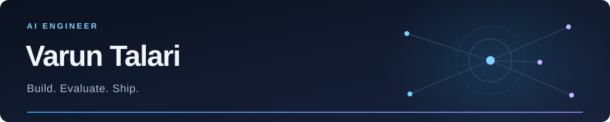

[Selected work](#selected-work) · [Case study](https://github.com/VarunTx/harness-ops/blob/main/docs/CASE_STUDY.md) · [Get in touch](mailto:ec20b1041@iiitdm.ac.in)

---

I build agentic applications with a focus on **context engineering, evaluation, and product delivery**. My work connects agent reasoning and tool use with the APIs, interfaces, and infrastructure needed to put a complete application in someone’s hands.

I take projects from an open-ended brief through implementation, testing, and deployment tooling. I use failure traces and feedback to decide what to improve, and choose the tools the problem calls for.

### Selected work

**[HarnessOps](https://github.com/VarunTx/harness-ops) — Agent improvement through feedback and evals**  
Built a support agent with progressively loaded skills, Git-versioned memory, and human-reviewed instruction changes. Each evaluation records the harness commit it tested. On small scenario sets, reported runs improved **3/14 → 14/14 in development** and **2/10 → 10/10 on a separate holdout**. [Results & engineering decisions →](https://github.com/VarunTx/harness-ops/blob/main/docs/CASE_STUDY.md)

**[Sunflower Grove](https://github.com/VarunTx/aws_hackathon) — Multi-agent workflows with verifiable answers**  
A six-agent front desk built for a hackathon, with specialist routing, tool calls, policy citations, and human handoffs. Combines decisions made in code with generated responses, a parent chat, and an operator dashboard.

**[Orchestra AI](https://github.com/VarunTx/orchestra-ai) — The systems around a running product**  
An open-source developer control plane bringing durable workflows, service monitoring, incident handling, and execution inspection into one dashboard, with self-hosted deployment and recovery tooling.

---

**Interested in applied AI and early engineering roles** where I can turn an ambiguous problem into a working feature, own the surrounding software, and keep improving it after launch.

[Email](mailto:ec20b1041@iiitdm.ac.in) · [More projects](https://github.com/VarunTx?tab=repositories)

### GitHub activity

  

<!-- Profile views count counter loads, not verified unique visitors. Third-party badges and stats may be cached or temporarily unavailable. -->
